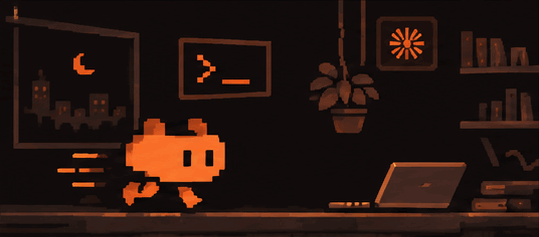
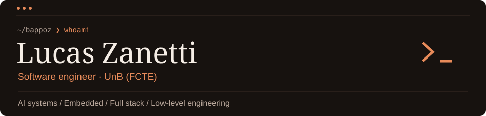

  
  <picture>
    <source media="(max-width: 600px)" srcset="./assets/profile-signature-mobile.svg" />
  
  </picture>

  
  
  

  <strong>Languages</strong>  
    
  <strong>Applications &amp; data</strong>  
    
  <strong>Infrastructure</strong>  
  

  

  

